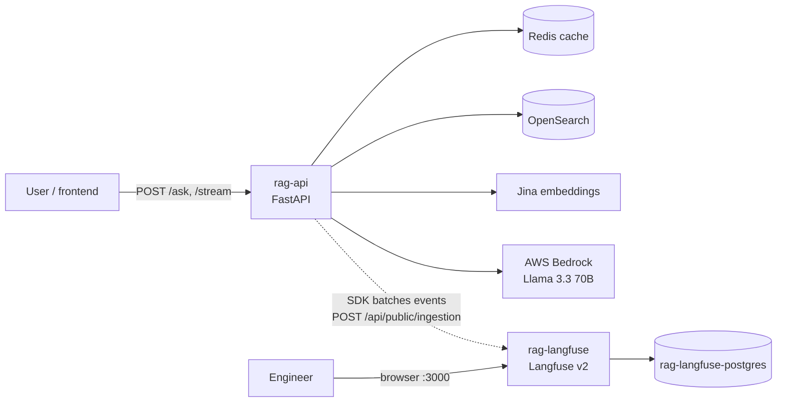
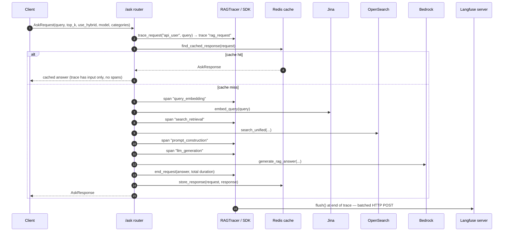
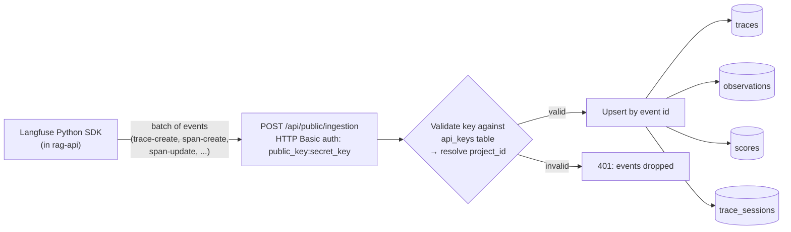

# Langfuse Integration: High-Level Design

How the RAG API traces each user question with self-hosted Langfuse v2, what that lets us monitor in the Langfuse UI, and how Langfuse stores the traces in PostgreSQL.

## 1. Components

| Component | Container | Role |
|---|---|---|
| RAG API (FastAPI) | `rag-api` | Serves `/api/v1/ask` and `/api/v1/stream`; emits trace data via the Langfuse Python SDK (v2) |
| `LangfuseTracer` | in `rag-api` | Thin wrapper over the SDK client. Disabled automatically when `LANGFUSE__ENABLED=false` or keys are missing ([client.py](../client.py)) |
| `RAGTracer` | in `rag-api` | RAG-specific helpers: one context manager per pipeline step ([tracer.py](../tracer.py)) |
| Langfuse server (v2) | `rag-langfuse` | Receives events over HTTP, writes them to Postgres, serves the UI on http://localhost:3000 |
| Langfuse Postgres | `rag-langfuse-postgres` | The only datastore for Langfuse v2: traces, spans, users, projects, API keys |
| App Postgres | `rag-postgres` | The RAG app's own data (papers). **Not used by Langfuse**; the two databases are fully separate |



Tracing is off the critical path where possible: if Langfuse is down or disabled, every tracer call returns `None`, and the request continues untraced.

## 2. How a user prompt is traced

### 2.1 Request flow

Each call to `/ask` or `/stream` opens one trace and adds a span for each pipeline step:



The SDK queues events in memory and a background thread sends them in batches (`LANGFUSE__FLUSH_AT=15` events or every `LANGFUSE__FLUSH_INTERVAL=1.0` s). `RAGTracer.trace_request` also calls `flush()` when each request finishes. On API shutdown, `main.py` calls `shutdown()` to send anything still queued.

### 2.2 What each trace contains

```
rag_request                          (trace)
│  input:    { query }
│  output:   { answer, total_duration_seconds, response_length }
│  user_id:  "api_user"   session_id: "session_api_user"
│
├── query_embedding                  (span; only when use_hybrid=true)
│     input:  { query, query_length }
│     output: { embedding_duration_ms, success }   ← or { success: false, error } on fallback to BM25
│
├── search_retrieval                 (span)
│     input:  { query, top_k }
│     output: { chunks_returned, unique_papers, total_hits, arxiv_ids }
│
├── prompt_construction              (span)
│     input:  { chunk_count }
│     output: { prompt_length, prompt_preview (first 200 chars) }
│
└── llm_generation                   (span)
      input:  { model, prompt_length, prompt (full) }
      output: { response, response_length, model_used }
```

Every span records a start and end time, so Langfuse shows how long each step took.

- `/ask` records the structured prompt (`create_bedrock_structured_prompt`), which is what `generate_rag_answer` sends.
- `/stream` records the plain prompt (`create_rag_prompt`), which is what `generate_rag_answer_stream` sends.
- For `/stream`, the `llm_generation` span covers the whole token stream, from first token to last.

### 2.3 Where it lives in code

| Concern | File |
|---|---|
| Tracer created once at startup, shut down on exit | [src/main.py](../../../main.py) (`lifespan`) |
| Injected into routes as `LangfuseDep` | [src/dependencies.py](../../../dependencies.py) |
| Spans around each pipeline step | [src/routers/ask.py](../../../routers/ask.py) |
| Settings (`LANGFUSE__*` env vars) | [src/config.py](../../../config.py) (`LangfuseSettings`) |

## 3. What we monitor in the Langfuse UI

| UI view | What it shows for this app | Questions it answers |
|---|---|---|
| **Traces** list | One row per question: query, answer, timestamp, total latency | What are people asking? Which requests were slow or failed? |
| **Trace detail** (timeline) | The span tree from §2.2, shown as a waterfall | Is the slow part Jina, OpenSearch or Bedrock? |
| `search_retrieval` output | `chunks_returned`, `unique_papers`, `arxiv_ids` | Did retrieval find anything? Is it all from one paper? Which papers back the answer? |
| `query_embedding` output | `success: false` + error | How often does hybrid search silently fall back to BM25? |
| `llm_generation` input/output | The exact prompt sent and the raw answer | Debugging hallucinations or poor answers against the actual context given |
| Trace input with no output | Cache hits (no spans, no output) | Rough cache hit rate |
| **Dashboard** | Trace volume and latency over time | Is load or latency trending up? |

### Not yet observable

These are features Langfuse has that the current instrumentation doesn't feed:

1. **Token usage and cost.** `llm_generation` is recorded as a plain span, so Langfuse's token and cost columns stay empty. `LangfuseTracer.create_generation(...)` exists for this. Recording the LLM call through it, with Bedrock's `usage`, would populate them. Bedrock Llama pricing would also need adding as a custom model under Settings → Models.
2. **Per-user views.** Every trace uses `user_id="api_user"`, so the Users and Sessions views show a single user. Passing a real user or session id from the frontend would split them.
3. **Quality scores.** `LangfuseTracer.score_trace(...)` exists but isn't called. Evaluation results such as faithfulness from the Phase 4 judge could be attached to traces as scores.
4. **Cache-hit tagging.** Cache hits are only recognizable as traces with no output. An explicit tag or metadata flag would make them filterable.

## 4. PostgreSQL's role in Langfuse v2

### 4.1 Postgres is Langfuse v2's only datastore

Langfuse v2 needs exactly one database: PostgreSQL. It holds both the application state (accounts, projects, keys) and all observability data (traces, spans, scores). There is no separate analytics store, queue or object store.

Langfuse v3 moved the trace data to ClickHouse and added Redis and S3/MinIO. That's why the v2.9x startup log prints `CLICKHOUSE_URL not configured, skipping migration`. It is a no-op on v2.

This project runs a **dedicated** Postgres for Langfuse (`rag-langfuse-postgres`, database `langfuse`, volume `langfuse_postgres_data`), separate from the app's `rag-postgres`. Trace volume therefore can't affect paper storage or ingestion, and either one can be backed up, reset or upgraded on its own.

### 4.2 Startup: schema migrations

On every container start, Langfuse runs its Prisma migrations against `DATABASE_URL`, about 270 of them, creating any missing tables, indexes and views. Migrations that are already applied are skipped, and progress is recorded in the `_prisma_migrations` table.

### 4.3 Write path: from SDK event to rows



1. **Authentication.** The SDK sends `LANGFUSE__PUBLIC_KEY` and `LANGFUSE__SECRET_KEY` as HTTP Basic auth. Langfuse looks up the key in `api_keys` (it stores a hash of the secret, never the plain secret) and resolves which **project** the events belong to. Every data row carries that `project_id`.
2. **Upsert.** Each event has a client-generated id. A create inserts a row. A later update to the same id (e.g. `span.update(output=...)` or `span.end()`) is merged into that row. That's how a span gets its output and end time after it started.
3. **Mapping to tables:**

| Our concept | Postgres table | Key columns |
|---|---|---|
| `rag_request` trace | `traces` | `id`, `project_id`, `name`, `timestamp`, `input`, `output`, `user_id`, `session_id`, `metadata`, `tags` |
| Each span (`query_embedding`, `search_retrieval`, ...) | `observations` | `id`, `trace_id`, `parent_observation_id`, `type` (SPAN / GENERATION / EVENT), `name`, `start_time`, `end_time`, `input`, `output`, `model`, token and cost columns |
| `session_api_user` | `trace_sessions` | `id`, `project_id` |
| Quality scores (future, §3) | `scores` | `trace_id`, `observation_id`, `name`, `value`, `source` |

`input`, `output` and `metadata` are JSONB columns, so the whole prompt and answer are stored as sent.

### 4.4 Read path: how the UI queries it

The UI doesn't read the raw tables directly for its lists. Langfuse defines two Postgres **views**:

- **`traces_view`** joins a trace with its observations to derive trace-level latency and totals.
- **`observations_view`** adds per-observation latency, time to first token, and cost. Cost comes from matching `model` against the `models` and `prices` tables. Because our LLM call is a SPAN with no usage (§3), cost is currently empty.

Filtering, search and the dashboard charts are SQL queries over these tables and views, using indexes on `project_id`, `trace_id` and `start_time`. This is what limits v2 at very high volume (millions of traces). For this project's volume, a few hundred traces a day, Postgres is comfortably sufficient.

### 4.5 Other Langfuse state in the same database

| Table(s) | Purpose |
|---|---|
| `users`, `Account`, `Session`, `verification_tokens` | UI sign-up and login (NextAuth) |
| `organizations`, `projects`, `organization_memberships`, `project_memberships` | Tenancy and access |
| `api_keys` | SDK credentials per project |
| `prompts` | Langfuse prompt management (unused here; our prompts live in `src/services/LLM/prompts`) |
| `datasets`, `dataset_items`, `dataset_runs`, `dataset_run_items` | Langfuse datasets (unused; our golden set is `src/evaluation/datasets`) |
| `models`, `prices` | Model-name → token-price mapping for cost |

### 4.6 Retention and backup

Langfuse v2 doesn't delete old traces automatically. Data grows in the `langfuse_postgres_data` Docker volume until traces are deleted in the UI or the volume is pruned. `docker compose down -v` deletes the volume, and with it all traces, the account, projects and API keys. After that, the `LANGFUSE__*_KEY` values in `.env` must be regenerated.

## 5. Configuration

| Env var (`.env`) | Default | Effect |
|---|---|---|
| `LANGFUSE__ENABLED` | `true` | Master switch |
| `LANGFUSE__PUBLIC_KEY` / `LANGFUSE__SECRET_KEY` | empty | Project keys from the Langfuse UI (Settings → API Keys). Empty → tracing disabled |
| `LANGFUSE__HOST` | `http://localhost:3000` | Overridden to `http://langfuse:3000` inside Docker by `compose.yml` |
| `LANGFUSE__FLUSH_AT` / `LANGFUSE__FLUSH_INTERVAL` | `15` / `1.0` | SDK batch size / interval |
| `LANGFUSE__DEBUG` | `false` | Verbose SDK logging |

First-time setup: open http://localhost:3000, sign up, create an organization and project, create API keys, put them in `.env`, then restart `rag-api`.

## 6. Failure behavior and known limits

| Situation | Behavior |
|---|---|
| Keys missing or `ENABLED=false` | The tracer logs "disabled" at startup. All calls are no-ops |
| Langfuse server down | The SDK can't send events, so traces are lost. Requests still succeed |
| Wrong keys (e.g. after a volume reset) | Ingestion returns 401 and events are dropped. Requests still succeed. Check `rag-api` logs |
| Exception inside a request | `/ask` catches it inside the trace and re-raises after the trace closes. The SDK's context manager can't have exceptions thrown through it |

Known limits:
- **Per-request flush latency.** `RAGTracer.trace_request` calls the SDK's `flush()` at the end of every request, and `flush()` blocks until the queue is sent. This adds a Langfuse round-trip to each `/ask` response. The background batching already sends events within `FLUSH_INTERVAL`, so removing the per-request flush would keep tracing without the added latency. The shutdown flush still guarantees delivery on exit.
- **No sampling.** Every request is traced, which is fine at this scale.
